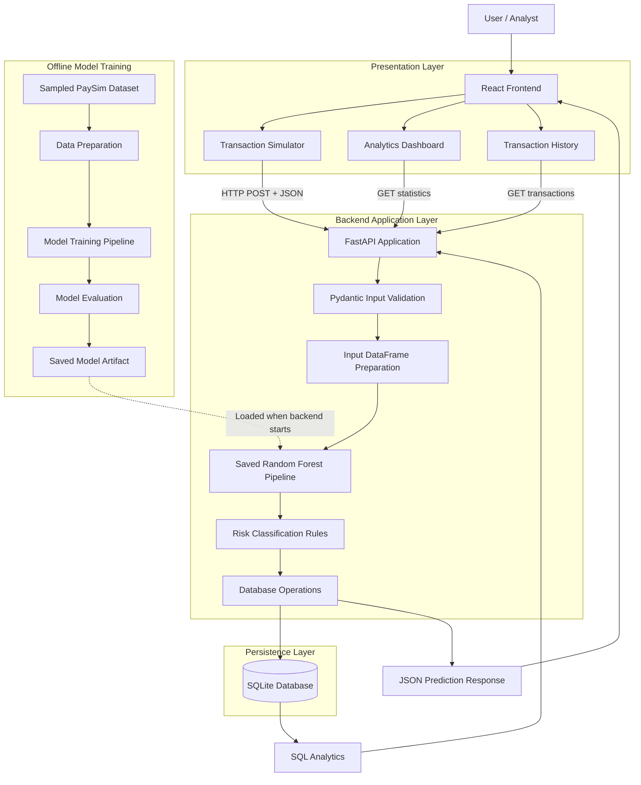
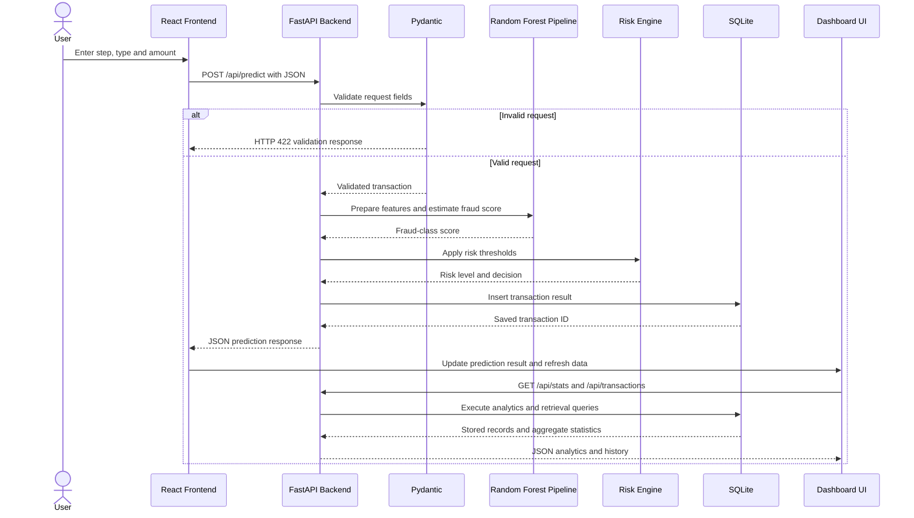
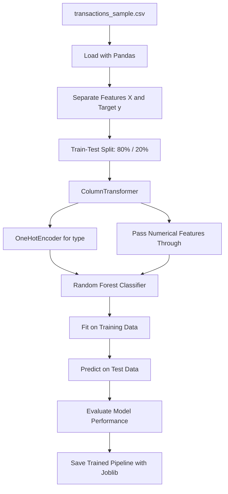

# FraudShield AI
### Machine Learning-Based Transaction Fraud Detection & Risk Analysis

FraudShield AI is a full-stack fraud detection prototype that combines machine learning, backend API development, database management, and transaction analytics to identify potentially suspicious financial transactions.

The system accepts transaction details, estimates fraud risk using a trained Random Forest classifier, applies rule-based risk thresholds, stores transaction results, and presents insights through an interactive React dashboard.

> **Project scope:** FraudShield AI is a demonstration and learning prototype built using a sampled synthetic transaction dataset. It does not connect to real banking infrastructure, authorize payments, or block actual financial transactions.

---

## Table of Contents

1. Project Overview
2. System Architecture
3. End-to-End Transaction Lifecycle
4. Technology Stack
5. Machine Learning Architecture
6. Backend Architecture
7. API Design
8. Database Design
9. Risk Classification Engine
10. Frontend Architecture
11. Model Evaluation and Fraud Metrics
12. Dataset Preparation
13. Project Directory Structure
14. Installation and Setup
15. Security and Error Handling
16. Current Limitations
17. Future Enhancements

---

## 1. Project Overview

FraudShield AI simulates the transaction screening workflow used in fraud monitoring systems.

The application combines two complementary approaches:

- **Machine learning:** Estimates the likelihood that a transaction belongs to the fraudulent class based on patterns learned from historical examples.
- **Rule-based decision logic:** Converts the model's output into an operational risk category and a recommended action.

The system also maintains a transaction history and calculates dashboard statistics, enabling users to explore flagged transactions and understand the results of the screening process.

### Key Features

- Interactive transaction risk assessment.
- Random Forest-based fraud classification.
- Input validation using Pydantic.
- REST API development using FastAPI.
- Rule-based risk classification using Python conditional logic.
- Persistent transaction storage using SQLite.
- SQL-based transaction analytics and dashboard statistics.
- Model evaluation using precision, recall, F1-score, ROC-AUC, average precision, and a confusion matrix.
- React dashboard for transaction simulation, results, history, and metrics.
- API testing through FastAPI's Swagger UI.

---

## 2. System Architecture

FraudShield AI follows a layered architecture in which each component has a distinct responsibility.

### High-Level Architecture Diagram



### Architectural Layers

| Layer | Technology | Responsibility |
|---|---|---|
| Presentation | React, JavaScript, CSS | Collects transaction inputs and displays results and analytics. |
| Communication | HTTP, REST, JSON | Transfers requests and responses between frontend and backend. |
| API | FastAPI | Exposes endpoints and coordinates application logic. |
| Validation | Pydantic | Checks incoming transaction fields against defined constraints. |
| ML inference | Pandas, scikit-learn, Joblib | Prepares model inputs and estimates fraud scores. |
| Decision engine | Python | Maps model scores to risk levels and recommended actions. |
| Persistence | SQLite | Stores transaction records and prediction outcomes. |
| Analytics | SQL | Aggregates transaction counts, flagged amounts, and risk statistics. |
| Model development | Pandas, scikit-learn | Prepares data, trains the classifier, and evaluates performance. |

The model training process is separate from transaction inference. Training creates the model artifact, while the running backend loads that artifact to make predictions.

---

## 3. End-to-End Transaction Lifecycle

The following sequence describes what happens when a user submits a transaction through the dashboard.



### Step-by-Step Execution

**Step 1: Transaction submission**

The user enters the following information in the React interface:

- `step`: Transaction time-step feature.
- `type`: Transaction category.
- `amount`: Transaction amount.

**Step 2: API request**

The frontend sends an HTTP POST request to `/api/predict`. The transaction details are serialized as JSON.

**Step 3: Request validation**

FastAPI uses a Pydantic model to validate the request. Invalid values are rejected before the prediction function executes.

**Step 4: Feature preparation**

The backend constructs a Pandas DataFrame containing the features in the format expected by the trained model.

**Step 5: ML inference**

The saved scikit-learn pipeline processes the features and estimates the score associated with the fraud class.

**Step 6: Risk classification**

Python conditional statements apply the configured thresholds to assign a risk level and recommendation.

**Step 7: Database persistence**

The backend inserts the transaction details, estimated score, risk category, decision, and UTC timestamp into SQLite.

**Step 8: API response**

The backend returns the prediction result as JSON, including the generated transaction ID.

**Step 9: Dashboard update**

React displays the result and retrieves updated transaction history and summary statistics.

---

## 4. Technology Stack

### Frontend

| Technology | Purpose |
|---|---|
| React | Component-based user interface. |
| JavaScript | Frontend application logic. |
| CSS | Layout, styling, responsive presentation, and dashboard design. |
| Fetch API | HTTP communication with the backend. |
| Recharts | Charts and transaction analytics visualizations. |
| Vite | Frontend development server and build tooling. |

### Backend

| Technology | Purpose |
|---|---|
| Python | Backend logic, inference, and decision rules. |
| FastAPI | REST API framework. |
| Uvicorn | ASGI server for running the application. |
| Pydantic | Request validation and data constraints. |
| Pandas | DataFrames and dataset manipulation. |
| scikit-learn | Preprocessing, Random Forest training, inference, and evaluation. |
| Joblib | Saving and loading the trained pipeline. |
| SQLite | Persistent transaction storage. |
| SQL | Data retrieval and analytical aggregation. |

### Development and Testing

- Visual Studio Code
- Python virtual environment
- npm
- FastAPI Swagger UI
- Git and GitHub

---

## 5. Machine Learning Architecture

### Model Selection

FraudShield AI uses a **Random Forest Classifier** implemented with scikit-learn.

Random Forest is an ensemble learning algorithm that combines predictions from multiple decision trees. It can model nonlinear relationships and interactions between input features.

The model is appropriate for this prototype because it supports classification, works with mixed numerical and categorical inputs after preprocessing, and provides feature-importance scores.

### Input Features

The current model uses three input features:

| Feature | Type | Description |
|---|---|---|
| `step` | Numerical | Time-step feature from the dataset. |
| `type` | Categorical | Transaction type, such as PAYMENT or TRANSFER. |
| `amount` | Numerical | Transaction amount. |

The target column is `isFraud`:

- `0` — Legitimate transaction.
- `1` — Fraudulent transaction.

The target label is used during training and evaluation, not as an input feature during prediction.

### Training Pipeline



### Feature and Target Separation

```python
X = data[["step", "type", "amount"]]
y = data["isFraud"]
```

- `X` contains the input features used to make predictions.
- `y` contains the known class labels used to teach the model.

### Train-Test Split

```python
train_test_split(
    X,
    y,
    test_size=0.20,
    random_state=42,
    stratify=y
)
```

- `test_size=0.20`: reserves 20% of the sampled dataset for evaluation.
- `random_state=42`: makes the randomized split reproducible.
- `stratify=y`: preserves approximately the same class proportions across the training and testing sets.

The test set is held out from model fitting so the evaluation can measure performance on unseen examples.

### Categorical Preprocessing

The transaction type is categorical, so the pipeline uses `OneHotEncoder` to convert it into numerical indicator features.

`handle_unknown="ignore"` allows the encoder to handle categories not observed during fitting without failing because of an unknown category.

The `ColumnTransformer` applies this encoding to `type` while passing the remaining numerical features through unchanged.

### Model Configuration

The classifier uses these principal settings:

| Parameter | Value | Purpose |
|---|---|---|
| `n_estimators` | `100` | Number of decision trees. |
| `class_weight` | `balanced_subsample` | Adjusts class weights based on each tree's sampled training data. |
| `random_state` | `42` | Makes the model's randomized behavior reproducible. |
| `n_jobs` | `-1` | Uses available CPU cores for parallel processing where supported. |

These are configuration choices for the current prototype, not proven optimal hyperparameters.

### Training and Inference

During training:

```python
model.fit(X_train, y_train)
```

The pipeline learns the preprocessing parameters and classifier patterns from the training data.

During inference:

```python
model.predict_proba(input_data)[0][1]
```

The pipeline estimates class probabilities for the input transaction and selects the score associated with class `1`, the fraud class.

The returned value is a model-estimated score. It should not automatically be interpreted as a calibrated real-world probability of fraud.

### Model Persistence

The trained pipeline is saved as:

```text
fraud_detector.joblib
```

The backend loads this artifact when the application starts, allowing inference without retraining the model for every transaction.

Saving the complete pipeline preserves both the fitted preprocessing stage and the trained classifier.

---

## 6. Backend Architecture

The backend is organized around API routes, request validation, ML inference, decision logic, and database operations.

### Application Initialization

When the FastAPI application starts, it:

1. Resolves the backend directory path.
2. Locates the saved model artifact.
3. Checks that the required model file exists.
4. Loads the trained pipeline using Joblib.
5. Creates the FastAPI application.
6. Configures CORS for the development frontend origins.
7. Initializes the SQLite transactions table if it does not exist.

Loading the model during initialization avoids repeatedly loading the artifact for each prediction request.

### Request Validation

The transaction request model defines the accepted structure:

```python
class TransactionRequest(BaseModel):
    step: int = Field(ge=1)
    type: TransactionType
    amount: float = Field(gt=0, le=1_000_000_000)
```

The schema constrains the step, transaction type, and amount. FastAPI uses these constraints to reject invalid request data before inference.

### Database Connection Management

The backend uses a context manager for database connections.

Its responsibilities are:

- Open a SQLite connection.
- Expose rows in a convenient row-based format.
- Commit successful operations.
- Roll back when an exception occurs.
- Close the connection when finished.

Prediction errors and database errors are handled separately so that a failed prediction or persistence operation can produce an appropriate HTTP error response.

### API Routes

| Method | Endpoint | Responsibility |
|---|---|---|
| GET | `/` | Returns basic application status. |
| POST | `/api/predict` | Validates, scores, classifies, and stores a transaction. |
| GET | `/api/transactions` | Retrieves recent transaction records. |
| GET | `/api/stats` | Returns aggregated dashboard statistics. |
| GET | `/api/feature-importance` | Returns saved model feature-importance data, if the corresponding route and artifact are present. |
| GET | `/api/model-metrics` | Returns saved evaluation metrics, if the corresponding route and artifact are present. |

The final two endpoints depend on the corresponding implementation in `main.py` and the generated artifacts being present.

### Prediction Endpoint Logic

The `/api/predict` endpoint performs the following operations:

1. Receives a validated `TransactionRequest`.
2. Constructs a one-row Pandas DataFrame.
3. Passes the DataFrame to the trained model.
4. Extracts the score for the fraud class.
5. Applies the risk thresholds.
6. Generates a UTC timestamp.
7. Inserts the result into SQLite.
8. Returns a JSON response.

This separates model inference from operational decision-making.

---

## 7. API Design

FraudShield AI exposes a REST-style API through FastAPI.

### Create a Prediction

**Endpoint:** `POST /api/predict`

Request body:

```json
{
  "step": 10,
  "type": "TRANSFER",
  "amount": 25000
}
```

Example response structure:

```json
{
  "id": 1,
  "transaction_type": "TRANSFER",
  "amount": 25000,
  "fraud_probability": 0.35,
  "fraud_probability_percent": 35.0,
  "risk_level": "MEDIUM",
  "decision": "REVIEW",
  "created_at": "2026-10-18T12:00:00+00:00",
  "model": "Random Forest"
}
```

*Illustrative response only. The actual score, ID, timestamp, and decision depend on the running application.*

### Retrieve Transactions

**Endpoint:** `GET /api/transactions?limit=100`

Returns recent saved transaction records, ordered from newest to oldest by database ID.

The optional `limit` query parameter is constrained to values between 1 and 500.

### Retrieve Dashboard Statistics

**Endpoint:** `GET /api/stats`

The endpoint calculates aggregate values such as:

- Total transactions.
- Transactions marked for review.
- Transactions marked for approval.
- Total amount associated with transactions marked for review.
- Average model-estimated fraud score.

The flagged amount represents transaction value selected for review. It is not confirmed fraud loss or money saved.

### API Validation and Error Responses

| Status code | Meaning |
|---|---|
| `200` | Successful request. |
| `422` | Request validation failed. |
| `500` | An internal processing or database error occurred. |
| `404` | A requested resource, such as a required metrics artifact, is unavailable where that error is implemented. |

Interactive documentation is available through FastAPI's Swagger UI at `/docs` when the local backend is running.

---

## 8. Database Design

FraudShield AI uses SQLite for persistent transaction records.

### Transactions Table

```sql
CREATE TABLE IF NOT EXISTS transactions (
    id INTEGER PRIMARY KEY AUTOINCREMENT,
    step INTEGER NOT NULL,
    transaction_type TEXT NOT NULL,
    amount REAL NOT NULL,
    fraud_probability REAL NOT NULL,
    risk_level TEXT NOT NULL,
    decision TEXT NOT NULL,
    created_at TEXT NOT NULL
);
```

### Column Definitions

| Column | Data type | Description |
|---|---|---|
| `id` | INTEGER | Unique, automatically generated transaction record ID. |
| `step` | INTEGER | Transaction time-step feature. |
| `transaction_type` | TEXT | Submitted transaction category. |
| `amount` | REAL | Transaction amount. |
| `fraud_probability` | REAL | Model-estimated score for the fraud class. |
| `risk_level` | TEXT | Assigned LOW, MEDIUM, or HIGH category. |
| `decision` | TEXT | APPROVE or REVIEW recommendation. |
| `created_at` | TEXT | UTC timestamp recorded when the transaction is processed. |

### Database Operations

The backend uses SQL for insertion, retrieval, and analytics.

**Insert transaction:** Saves the submitted features and prediction outcome.

**Retrieve transaction history:** Selects recent rows, sorts by ID in descending order, and applies a result limit.

**Calculate dashboard metrics:** Uses SQL aggregate functions and conditional expressions.

For example:

```sql
SELECT
    COUNT(*) AS total_transactions,
    SUM(
        CASE
            WHEN decision = 'REVIEW' THEN 1
            ELSE 0
        END
    ) AS flagged_transactions
FROM transactions;
```

This query counts all transaction records and separately counts those marked for review.

The insertion query uses parameterized SQL placeholders rather than concatenating user input into the SQL statement.

---

## 9. Risk Classification Engine

The risk engine translates the model's estimated score into a risk category and recommended action.

### Current Decision Policy

| Fraud-class score | Risk level | Recommendation |
|---|---|---|
| Below `0.20` | LOW | APPROVE |
| `0.20` to below `0.50` | MEDIUM | REVIEW |
| `0.50` or above | HIGH | REVIEW |

The thresholds are implemented through Python `if`, `elif`, and `else` statements.

```python
if fraud_probability >= 0.50:
    risk_level, decision = "HIGH", "REVIEW"
elif fraud_probability >= 0.20:
    risk_level, decision = "MEDIUM", "REVIEW"
else:
    risk_level, decision = "LOW", "APPROVE"
```

### Why Separate ML and Business Rules?

The ML model estimates a score, while the decision engine determines how the application responds to that score.

This separation makes it possible to change decision thresholds without necessarily retraining the classifier.

In a production fraud-control system, threshold selection should consider false-positive costs, missed-fraud costs, investigation capacity, customer impact, and validation on representative data.

The current thresholds are demonstration settings rather than business-validated banking policies. The prototype recommends approval or review; it does not execute payment authorization.

---

## 10. Frontend Architecture

The React application provides the user-facing interface for transaction screening and analytics.

### Main Functional Areas

**Transaction Simulator**

- Accepts transaction amount, type, and step.
- Sends a POST request to the prediction endpoint.
- Displays the returned score, risk category, and recommendation.

**Analytics Dashboard**

- Displays summary statistics retrieved from `/api/stats`.
- Visualizes transaction data through charts.
- Helps users understand aggregate screening activity.

**Transaction History**

- Retrieves recent records from `/api/transactions`.
- Displays transaction details and screening outcomes.
- Supports the project's available history filtering and presentation features.

**API Communication**

The frontend uses the Fetch API to communicate with FastAPI.

The request lifecycle is asynchronous: React sends the request, waits for the response, parses JSON, and updates component state.

A robust production implementation should explicitly handle loading states, network failures, non-success HTTP responses, and malformed responses.

### Development Origins

The default local development setup uses:

- React/Vite frontend: `http://localhost:5173`
- FastAPI backend: `http://127.0.0.1:8000`

The backend CORS configuration permits the specified development origins. These settings should be reviewed and replaced with an appropriate deployment configuration before hosting the application publicly.

---

## 11. Model Evaluation and Fraud Metrics

The training pipeline evaluates the model on the held-out test set.

### Evaluation Methods

| Metric | Purpose |
|---|---|
| Accuracy | Fraction of all test examples classified correctly. |
| Precision | Fraction of positive fraud predictions that are actual fraud cases. |
| Recall | Fraction of actual fraud cases correctly identified. |
| F1-score | Harmonic mean of precision and recall. |
| Confusion matrix | Counts true negatives, false positives, false negatives, and true positives. |
| ROC-AUC | Measures ranking discrimination across classification thresholds. |
| Average precision | Summarizes the precision-recall curve, particularly useful for imbalanced classification. |

### Confusion Matrix

For class labels `0 = legitimate` and `1 = fraud`, the matrix follows this layout:

| | Predicted legitimate | Predicted fraud |
|---|---|---|
| Actual legitimate | True Negative (TN) | False Positive (FP) |
| Actual fraud | False Negative (FN) | True Positive (TP) |

A false positive may create unnecessary review work or customer friction. A false negative represents fraud that the model failed to identify.

Fraud datasets are often imbalanced, meaning legitimate transactions greatly outnumber fraudulent transactions. Consequently, accuracy alone can create a misleading impression of model quality.

### Evaluation Considerations

- Precision and recall should be examined together.
- The business impact of missed fraud should be compared with the cost of false alarms.
- The evaluation dataset should reflect the intended deployment population.
- Metrics should be validated on data that is representative of future transactions.
- A strong ROC-AUC score does not guarantee that a particular score threshold is appropriate.
- Model-estimated scores should be calibrated and evaluated before being interpreted as reliable real-world probabilities.

The classification report and confusion matrix in the current training script use the classifier's default predicted classes. The API's LOW, MEDIUM, and HIGH categories use separate thresholds of `0.20` and `0.50`. Therefore, the standard classification report does not directly evaluate that exact business decision policy.

---

## 12. Dataset Preparation

The model training workflow uses a sampled version of the PaySim dataset, a synthetic mobile-money transaction dataset.

Original dataset reference:

https://www.kaggle.com/datasets/ealaxi/paysim1

The preparation script:

1. Reads the original CSV in chunks to limit memory usage.
2. Separates fraudulent and legitimate rows within each chunk.
3. Retains all available fraud rows in each processed chunk.
4. Samples approximately 3% of legitimate rows per chunk.
5. Combines the selected rows.
6. Retains `step`, `type`, `amount`, and `isFraud`.
7. Removes rows with missing values.
8. Saves the prepared dataset as `transactions_sample.csv`.

### Why Sample the Dataset?

The sampling approach reduces the number of legitimate transactions used for training, making the dataset more manageable while retaining fraud examples from the processed source.

### Important Data Limitation

Because all fraud rows are retained while only a fraction of legitimate rows is sampled, the resulting fraud prevalence differs from the original dataset.

This affects how representative the sampled data is of real transaction traffic. In particular, model-estimated scores and evaluation metrics should not be assumed to reflect real-world banking performance or actual fraud prevalence.

PaySim is synthetic data, not a dataset of real customer banking records.

---

## 13. Project Directory Structure

The project is organized into separate frontend and backend directories.

```text
FraudShield-AI/
│
├── backend/
│   ├── .venv/
│   ├── main.py
│   ├── train_model.py
│   ├── prepare_data.py
│   ├── PS_20174392719_1491204439457_log.csv
│   ├── transactions_sample.csv
│   ├── fraud_detector.joblib
│   ├── transactions.db
│   ├── evaluation_metrics.json
│   └── feature_importance.csv
│
├── frontend/
│   ├── src/
│   │   ├── App.jsx
│   │   ├── components/
│   │   └── ...
│   ├── public/
│   ├── package.json
│   └── ...
│
└── README.md
```

This is an illustrative structure of the project's artifacts. The optional evaluation and feature-importance files are present only if the corresponding training code generates them. Exact filenames and additional files may vary with the current implementation.

The SQLite database and generated model artifacts are runtime or build outputs; they should be managed deliberately rather than committed automatically.

---

## 14. Installation and Setup

### Prerequisites

- Python 3.12 or a compatible Python version.
- Node.js and npm.
- Git.
- A local copy of the repository.
- The PaySim CSV file if retraining from the original dataset.

### Backend Setup

Open a terminal in the backend directory:

```powershell
cd backend
python -m venv .venv
.\.venv\Scripts\Activate.ps1
python -m pip install --upgrade pip
pip install fastapi "uvicorn[standard]" pandas scikit-learn joblib numpy
```

Place the original PaySim CSV in the backend directory before running data preparation.

Prepare the dataset:

```powershell
python prepare_data.py
```

Train the model:

```powershell
python train_model.py
```

The training script should generate `fraud_detector.joblib`. Any additional metrics or feature-importance artifacts depend on the implementation of that script.

Start the backend:

```powershell
python -m uvicorn main:app --reload
```

The API should be available at:

```text
http://127.0.0.1:8000
```

Interactive API documentation:

```text
http://127.0.0.1:8000/docs
```

The saved model must exist before starting the backend.

### Frontend Setup

Open a second terminal:

```powershell
cd frontend
npm install
npm run dev
```

Open the local URL printed by Vite, typically:

```text
http://localhost:5173
```

Ensure the backend is running and that the frontend's configured API base URL matches the backend address.

---

## 15. Security and Error Handling

The prototype includes several basic application safeguards.

### Input Validation

Pydantic constrains transaction fields before they reach the model.

### Parameterized SQL

Database writes use parameterized queries to reduce SQL injection risk.

### Error Handling

The API handles prediction and database failures through HTTP error responses rather than intentionally returning internal exception details to the client.

### CORS Configuration

The backend specifies permitted frontend origins for browser-based cross-origin requests. CORS does not authenticate users and does not prevent direct requests from arbitrary non-browser clients.

### Additional Production Requirements

A production-grade fraud platform would require substantially more controls, including:

- Authentication and role-based authorization.
- Strict request-size and rate limits.
- Secure secret and configuration management.
- Restricted network and database access.
- Centralized logging and monitoring.
- Data encryption and retention policies.
- Model artifact integrity checks.
- Protection against unauthorized model or dataset replacement.
- Audit trails for analyst decisions.
- Testing, deployment controls, and incident-response procedures.

Joblib artifacts should only be loaded from trusted sources because deserializing an untrusted artifact can execute malicious code.

---

## 16. Current Limitations

FraudShield AI is an educational prototype, and its current design has important limitations.

1. **Synthetic dataset:** Training uses PaySim data rather than real banking transaction records.
2. **Limited features:** The model uses only `step`, `type`, and `amount`.
3. **Sampling bias:** The prepared dataset has a different fraud prevalence from the original data.
4. **Uncalibrated scores:** `predict_proba()` outputs are not guaranteed to represent calibrated real-world fraud probabilities.
5. **Demonstration thresholds:** The risk thresholds are illustrative and have not been optimized against measured business costs.
6. **Limited transaction context:** The current model does not use account history, device fingerprints, location anomalies, velocity features, or transaction sequences.
7. **No live payment integration:** The system does not connect to banking rails or authorize or block real transactions.
8. **No verified outcomes for simulated requests:** The application stores model predictions but does not automatically know whether each newly submitted transaction is truly fraudulent.
9. **No confirmed loss prevention:** The total flagged amount is a review-workload measure, not a measure of fraud prevented or money saved.
10. **Prototype deployment:** Authentication, production-grade monitoring, model governance, and comprehensive security controls are not yet implemented.

These limitations define the current scope and provide a roadmap for further development.

---

## 17. Future Enhancements

Potential improvements include:

### Machine Learning

- Add transaction frequency and velocity features.
- Incorporate account history and behavioral patterns.
- Evaluate alternative classification algorithms.
- Tune decision thresholds using business costs.
- Calibrate predicted probabilities.
- Evaluate performance over time using time-based splits.
- Monitor data drift and model performance.
- Add explainability tools for individual predictions.

### Backend and Data

- Add authentication and role-based access control.
- Migrate SQLite to PostgreSQL for a multi-user deployment.
- Add structured logging and request tracing.
- Build an auditable analyst review workflow.
- Add pagination and filtering to transaction history.
- Separate prediction records from confirmed fraud labels.
- Add automated testing for API endpoints and decision rules.

### Dashboard and Analytics

- Add time-based fraud trends.
- Compare flagged rates by transaction type.
- Track precision, recall, and false-positive rates once ground-truth labels are available.
- Add analyst feedback and review outcomes.
- Show model version and evaluation metadata.
- Support exportable reports for investigation and audit workflows.

### Production Readiness

A production system would need representative data, rigorous evaluation, calibrated and validated decision policies, secure deployment, operational monitoring, and integration with authorized payment or case-management systems.

---

## Conclusion

FraudShield AI demonstrates an end-to-end fraud screening workflow by combining a React interface, a FastAPI backend, a trained Random Forest pipeline, Python decision rules, SQLite persistence, and SQL-based analytics.

The project highlights practical skills relevant to fraud-control and analytics roles: programming logic, Boolean conditions, REST APIs, JSON, SQL queries, data preparation, model evaluation, and interpretation of fraud-related metrics.

The primary goal is to make transaction screening understandable and auditable while establishing a foundation for more advanced fraud analytics.

**Built as a learning and portfolio project focused on fraud detection, risk analysis, and full-stack ML integration.**
