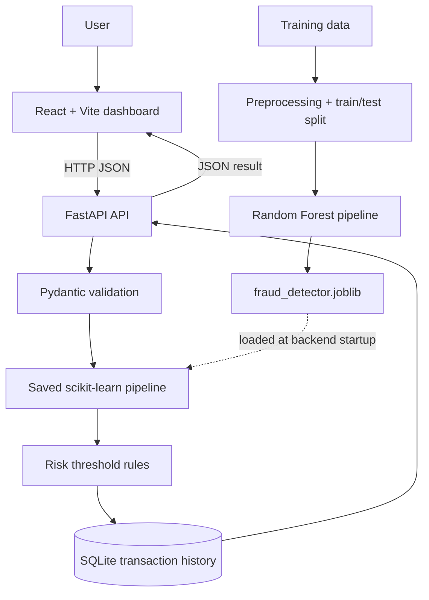

# FraudShield AI
### ML-Based Transaction Fraud Screening Prototype

FraudShield AI is a full-stack portfolio prototype that estimates transaction fraud risk using a scikit-learn Random Forest pipeline, applies configurable risk thresholds, stores screening results in SQLite, and displays results in a React dashboard.

> **Scope:** This is a learning/demo prototype. It does not connect to a bank, authorize payments, block real transactions, or establish real-world fraud prevention. The included demo data is synthetic.

## Architecture



## Features
- Transaction simulator (amount, type, time-step)
- Fraud-class score from a trained Random Forest pipeline
- LOW / MEDIUM / HIGH risk categories and APPROVE / REVIEW recommendations
- SQLite persistence and transaction history
- Summary statistics and recent transaction display
- API request validation with Pydantic
- Swagger UI at `/docs`
- Model evaluation metrics generated during training

## Stack
- Frontend: React, Vite, JavaScript, CSS, Recharts
- Backend: Python, FastAPI, Uvicorn, Pydantic
- ML/data: pandas, scikit-learn, joblib, NumPy
- Storage: SQLite

## Folder structure
```text
FraudShield-AI/
├── backend/
│   ├── main.py
│   ├── train_model.py
│   ├── generate_demo_data.py
│   ├── prepare_data.py
│   ├── requirements.txt
│   └── .gitignore
├── frontend/
│   ├── index.html
│   ├── package.json
│   ├── vite.config.js
│   └── src/
│       ├── main.jsx
│       ├── App.jsx
│       ├── App.css
│       └── index.css
├── .gitignore
└── README.md
```

## Run locally (Windows PowerShell)

### 1. Backend
Open a terminal at the project root:

```powershell
cd backend
python -m venv .venv
.\.venv\Scripts\Activate.ps1
pip install -r requirements.txt
python generate_demo_data.py
python train_model.py
python -m uvicorn main:app --reload
```

The backend runs at `http://127.0.0.1:8000`; Swagger UI is at `http://127.0.0.1:8000/docs`.

### 2. Frontend
Open a second terminal at the project root:

```powershell
cd frontend
npm install
npm run dev
```

Open the URL printed by Vite, typically `http://localhost:5173`.

### Use PaySim data instead
If you have downloaded the original PaySim CSV, place it in `backend/` named `PS_20174392719_1491204439457_log.csv`, then run `python prepare_data.py` instead of `python generate_demo_data.py`, followed by `python train_model.py`. The PaySim sampling approach retains fraud examples and samples 3% of legitimate rows; this changes class prevalence and can affect model score interpretation.

## API endpoints
| Method | Endpoint | Purpose |
|---|---|---|
| GET | `/` | Health/status response |
| POST | `/api/predict` | Validate, score, classify, and save a transaction |
| GET | `/api/transactions?limit=100` | Retrieve recent transactions |
| GET | `/api/stats` | Return summary statistics |
| GET | `/api/model-metrics` | Return saved test-set metrics |
| GET | `/api/feature-importance` | Return saved feature-importance values |

### Example prediction request
```json
{
  "step": 10,
  "type": "TRANSFER",
  "amount": 25000
}
```

## Decision policy
- Score below `0.20`: LOW → APPROVE
- Score from `0.20` to below `0.50`: MEDIUM → REVIEW
- Score `0.50` or above: HIGH → REVIEW

These are demonstration thresholds, not banking standards. `predict_proba()` scores are not guaranteed to be calibrated real-world fraud probabilities. The `flagged_amount` statistic is the sum of transaction amounts marked for review, not confirmed fraud loss or money saved.

## Important limitations
- Demo data generated by `generate_demo_data.py` is synthetic and does not represent real customers or real fraud patterns.
- Only `step`, `type`, and `amount` are used as model features.
- The prototype does not integrate with payment networks or block transactions.
- Evaluation results on synthetic/sampled data do not establish production performance.
- Authentication, production monitoring, rate limiting, and production deployment hardening are not included.

## Git hygiene
Do not commit `.venv/`, `node_modules/`, generated SQLite databases, large raw datasets, or secrets. The trained model and evaluation files are generated by the training script and can be regenerated locally.
